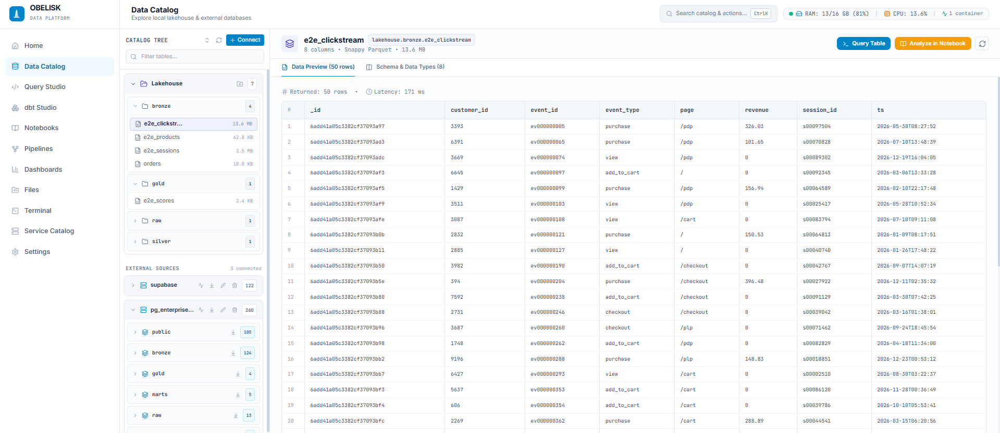
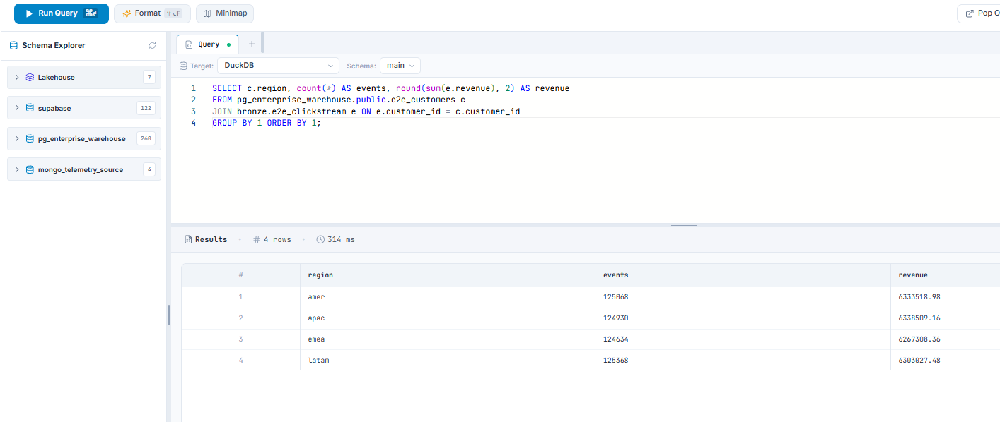
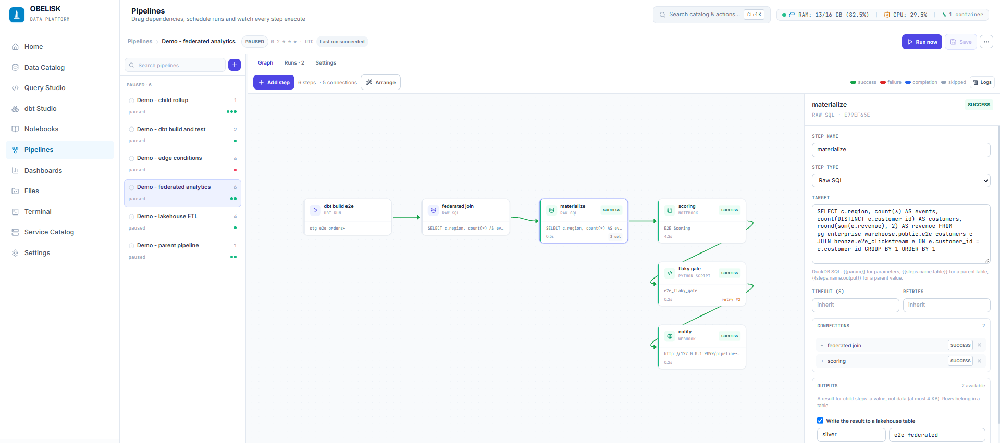

# Obelisk

<div align="center">

**The Pluggable On-Premise Data Platform & Control Plane**

Run a complete modern data stack on a workstation, a single server, or an air-gapped appliance.

[](LICENSE)
[](https://www.python.org/)
[](https://duckdb.org/)
[](https://fastapi.tiangolo.com/)
[](https://react.dev/)

<p align="center">
  
</p>

</div>

---

## What it is

Obelisk ingests from your databases, keeps the data as Parquet in a local lakehouse, queries
it in-process with DuckDB, and runs dbt, notebooks and scripts on a schedule. No cloud
warehouse, no cluster to operate, no egress bill.

- **In-process DuckDB over Parquet.** Vectorized analytical SQL straight off the files.
- **The catalog is a projection.** A table address *is* its folder (`lakehouse.raw.orders`).
  Nothing is registered, so a table can never be listed with no file behind it.
- **One orchestrator, in-process.** Scripts, notebooks, dbt, raw SQL, webhooks and other
  pipelines, wired with `success` / `failure` / `completion` / `skipped` edges.
- **Federation when you need it.** Postgres sources attach live into DuckDB, so one query
  can join them to lakehouse tables. The editor and every pipeline step share the resolver.
- **Batteries included.** Monaco SQL studio, dbt Studio with lineage, reactive Marimo
  notebooks stored as `.py`, an encrypted vault, and hardware-aware container sizing.

## Status

Under active development.

**No authentication is enforced yet.** The seam exists (`OBELISK_AUTH_ENABLED`) and every
request already resolves a principal, but until you turn it on, treat the API as
trusted-network only.

The in-app terminal is a **real shell on the host** -- origin-gated, session-capped and
audited, but a shell. Set `OBELISK_TERMINAL=0` to remove it on a shared deployment.

## Quickstart

Python 3.12+ and Node 20+ (Node is only needed for the UI dev server).

```bash
git clone https://github.com/amrelsawalhi/obelisk.git
cd obelisk
cp .env.example .env      # Windows: copy .env.example .env

# Windows
run_obelisk.bat

# Linux / macOS / WSL
bash run_obelisk.sh
```

One command starts the API on `:8000` and the UI on `:5173`, then opens the browser. The
launcher guards port 8000 and replaces a stale listener (`run_obelisk.bat --restart`).

Other installs -- production Docker behind a Caddy gateway on `:80`, a systemd unit, or a
manual venv -- are in [docs/configuration.md](docs/configuration.md).

Want live sources to play with? `docker compose -f docker-compose.sources.yml up -d` starts
Postgres on `:5434` and MongoDB on `:27018`.

## What you can do

**Catalog and ingest.** Introspect lakehouse folders and connected databases, then stream
tables in as Snappy Parquet with `snapshot`, `incremental` (watermark) or `upsert`
(primary key) semantics. Attachable sources (Postgres) can also be queried live, uncopied.

**Query Studio.** DuckDB in-process, CSV and Parquet export, a virtualized grid, and
federated joins in one statement:

```sql
SELECT c.region, count(*) AS events, round(sum(e.revenue), 2) AS revenue
FROM pg_enterprise_warehouse.public.e2e_customers c
JOIN bronze.e2e_clickstream e ON e.customer_id = c.customer_id
GROUP BY 1 ORDER BY 1;
```

<p align="center">
  
</p>

**Pipelines.** A canvas with conditional edges; step **outputs** bound downstream
(`{{steps.build.table}}`); retries with attempt history; SQL that materializes to a table;
pipelines that run other pipelines with recorded lineage; logs that stream while a step is
still running; durable run history and re-run-from-step.

<p align="center">
  
</p>

**dbt Studio.** Edit, compile, preview and run models in the browser, with lineage. A
`dbt_run` step can stage a lakehouse folder into the warehouse before it builds.

**Notebooks.** Reactive Marimo notebooks saved as plain `.py` under `git_repo/notebooks/`,
one click from any table, and runnable headlessly as a pipeline step.

**Vault.** Variables and credentials encrypted at rest with Fernet and decrypted only in
memory, at execution time: `obelisk.var("OPENAI_API_KEY")`.

## Verify it works

```bash
cd backend
python -m pytest tests -q                        # the backend suite, no external services needed
python scripts/verify_pipelines.py               # every step type, every edge condition
python scripts/e2e/verify_e2e.py --scale small   # full journey, live Postgres + Mongo
```

The end-to-end script seeds real sources, drives ingest, dbt and federated SQL, forces every
edge condition, then reconciles the lakehouse against the sources -- no expected value is
hardcoded. Details in [docs/testing.md](docs/testing.md).

## Learn more

- [Architecture](docs/architecture.md) -- control plane, storage seam, catalog projection
- [Python SDK](docs/sdk.md) -- `table`, `query`, `save`, `var`, `spark`
- [Configuration](docs/configuration.md) -- every environment variable, ports, installs
- [Testing](docs/testing.md) -- the zero-mock discipline and both verification harnesses
- [`.env.example`](.env.example) -- the canonical settings list

## License

MIT -- see [LICENSE](LICENSE).

Built with ❤️ for data engineers who value speed, autonomy, and simplicity.
