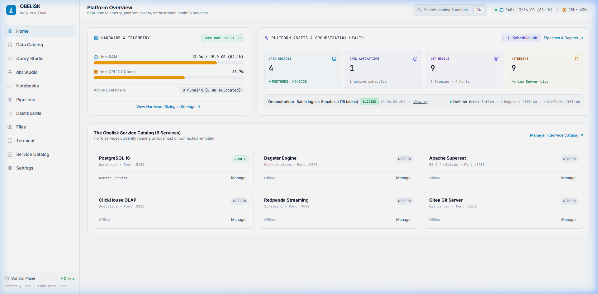
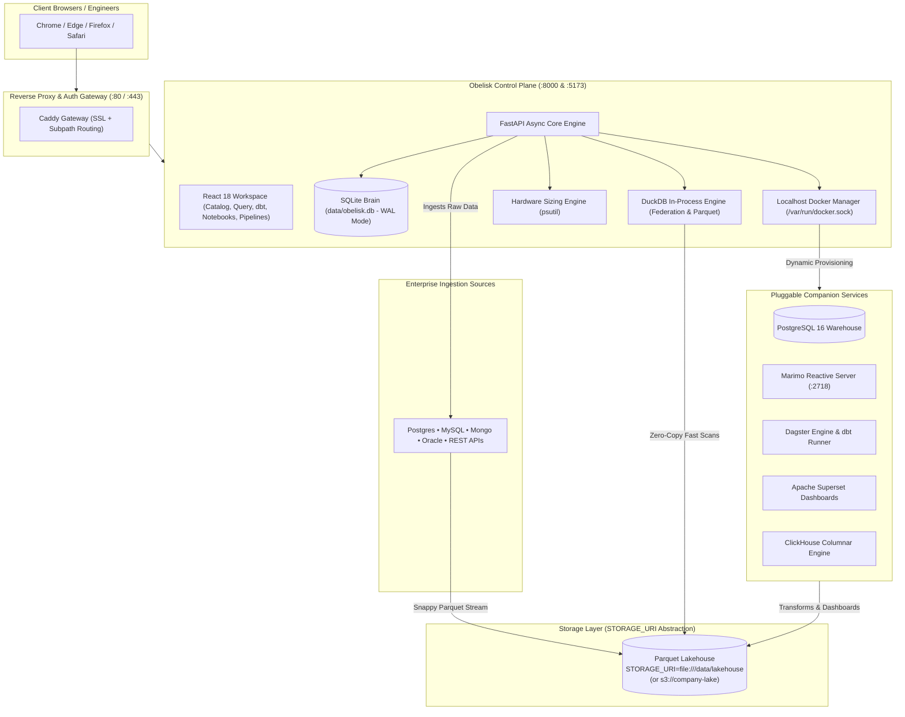
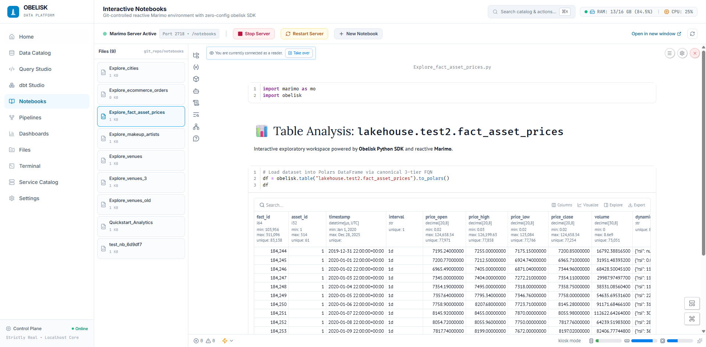
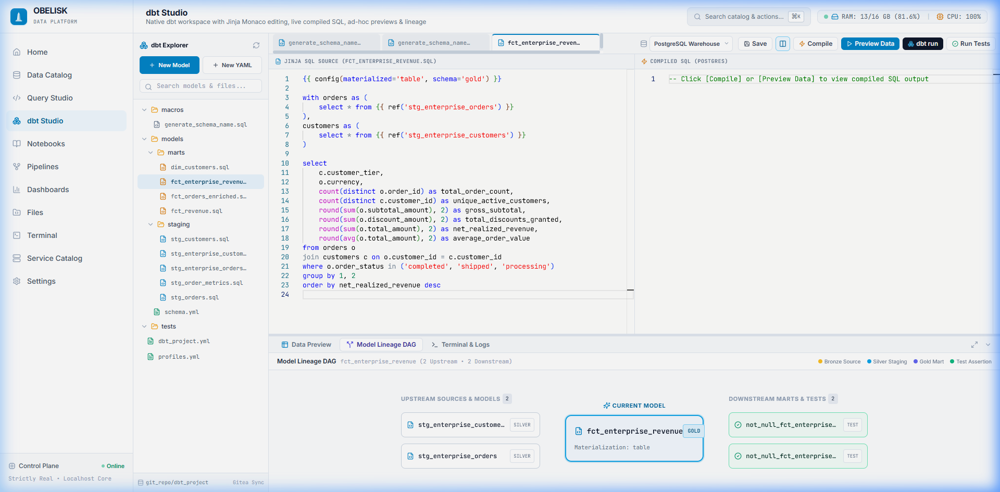
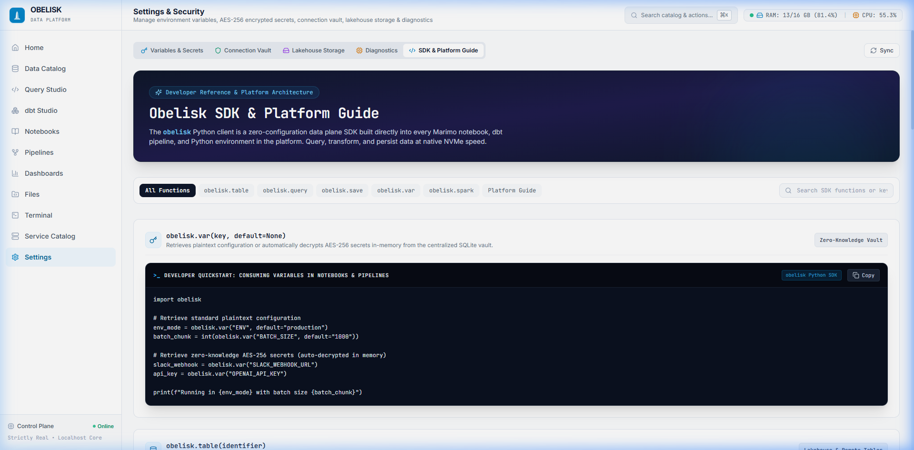
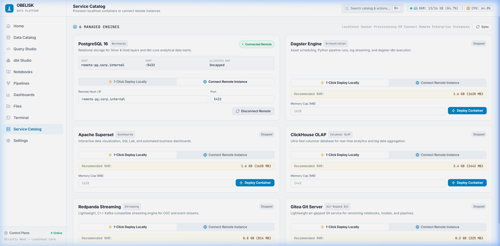

# 🏛️ Obelisk

<div align="center">

**The Pluggable On-Premise Data Platform & Control Plane**

*Run a complete modern data stack on any workstation, single server, or air-gapped appliance with zero cloud tax.*

[](LICENSE)
[](https://www.python.org/)
[](https://duckdb.org/)
[](https://react.dev/)
[](https://fastapi.tiangolo.com/)
[](https://www.getdbt.com/)
[](https://marimo.io/)

[Key Features](#-key-features) •
[Architecture](#-architecture) •
[Quickstart](#-quickstart) •
[Python SDK (`obelisk`)](#-the-obelisk-python-sdk) •
[Service Catalog](#-pluggable-service-catalog) •
[Configuration](#-zero-cost-storage-uri-abstraction)

<br/>

<p align="center">
  
</p>

</div>

---

## 🌟 Vision & Overview

Enterprise data teams often face a painful dilemma: either pay exorbitant cloud bills for multi-tenant SaaS warehouses (Snowflake, Databricks, BigQuery) with vendor lock-in and steep egress fees, or spend months stitching together fragile, self-hosted open-source tools with manual networking and configuration drift.

**Obelisk** is a unified, self-hosted data platform and control plane that brings the entire modern data stack to a single host. From raw ingestion and in-process OLAP querying to Git-controlled reactive notebooks, dbt modeling, and automated pipelines — Obelisk gives you complete control over your data with zero cloud tax.

<p align="center">
  
</p>

### Core Tenets:
* ⚡ **Zero-Cost Storage URI Abstraction (`STORAGE_URI`):** Scale from an NVMe SSD (`file:///data/lakehouse`) to enterprise S3/MinIO (`s3://lakehouse`) with zero code rewrites.
* 🦆 **In-Process DuckDB Engine:** Sub-second vectorized analytical SQL across local Snappy Parquet files and remote databases without ETL overhead.
* 📦 **Strictly Real Localhost Provisioning:** 1-Click deploy local containers with dynamic hardware-aware memory sizing, or seamlessly connect existing remote databases.
* 📓 **Git-Controlled Reactive Notebooks:** Interactive Marimo notebooks saved as clean Python files (`.py`) under version control.
* 🔐 **Zero-Knowledge Security:** In-memory AES-256 Fernet crypto vault for all credentials and secrets.

---

## 🏗️ Architecture



---

## 🚀 Key Features

### 1. Unified Data Catalog & 1-Click Ingest
* Recursively introspects local Lakehouse Parquet folders and connected external databases (PostgreSQL, Supabase, MySQL, MongoDB, Oracle).
* **1-Click Ingest:** Stream tables directly from source databases into Snappy Parquet files.
* Supports **Full Snapshot** and **Incremental Watermark** modes.

<p align="center">
  
</p>

### 2. Monaco Query Studio
* In-browser SQL studio powered by in-process **DuckDB**.
* Cross-source federated joins: join Lakehouse Parquet files directly with remote production databases in a single query.
* **Instant Virtualized DataGrid:** Renders 10,000+ rows smoothly at 60 FPS using DOM windowing without browser lag.
* Binary **CSV** and **Parquet** streaming exports directly from memory.

<p align="center">
  
</p>

### 3. Git-Controlled Marimo Notebooks
* Embedded reactive Python notebooks running on `:2718` in headless directory server mode.
* Stored as clean, readable Python scripts (`git_repo/notebooks/*.py`) that version-control cleanly in Git without noisy JSON diffs.
* **1-Click [ Analyze in Notebook ]:** Launch an interactive exploratory session pre-loaded with `import obelisk` and your target dataset.

<p align="center">
  
</p>

### 4. Browser-Based dbt Studio
* Edit, compile, and run `dbt-core` models directly in the UI.
* Visual DAG lineage graph displaying source-to-mart dependency trees.
* Automated staging model generation and real-time execution logs.

<p align="center">
  
</p>

### 5. Pipelines & Cron Orchestration
* Define recurring ingestion, transformation, and custom Python tasks.
* Standard 5-part cron scheduling (`*/15 * * * *`) with persistent task states in SQLite.
* Live streaming execution logs and asset dependency tracking.

<p align="center">
  
</p>

### 6. Zero-Knowledge Connection & Variable Vault
* Centralized storage for environment variables and secrets.
* Confidential credentials encrypted at rest using **AES-256 Fernet** cryptography.
* Auto-decrypted only in memory at execution time when accessed via `obelisk.var("KEY")`.

---

## 💻 The Obelisk Python SDK

Every Marimo notebook, dbt pipeline, and Python script has direct access to `obelisk` without manual database connection strings.

<p align="center">
  
</p>

```python
import obelisk
import polars as pl

# 1. Load any Lakehouse table (flat or folder-nested) or external database
tbl = obelisk.table("venues")                       # 1-tier bare table auto-discovery
tbl_bronze = obelisk.table("lakehouse.raw.orders")   # 3-tier canonical FQN
tbl_remote = obelisk.table("supabase.public.users")  # Connected database table

# Zero-copy conversions across analytical formats
df_polars = tbl.to_polars()   # High-speed Polars DataFrame
df_arrow  = tbl.to_arrow()    # Apache Arrow Table (zero-copy)
df_pandas = tbl.to_df()       # Standard Pandas DataFrame
duck_rel  = tbl.to_duckdb()   # DuckDB PyRelation

# 2. Execute cross-source federated SQL in DuckDB
df_joined = obelisk.query("""
    SELECT 
        o.order_id, 
        o.amount, 
        u.email, 
        u.company 
    FROM lakehouse.raw.orders o
    JOIN supabase.public.users u ON o.customer_id = u.id
    WHERE o.amount > 100.0
    ORDER BY o.amount DESC
    LIMIT 25;
""")

# 3. Atomically persist results to Lakehouse Snappy Parquet
# Saves to data/lakehouse/analytics/high_value_orders.parquet and syncs metadata
obelisk.save(df_joined, "analytics.high_value_orders")

# 4. Access encrypted secrets & configuration from the vault
api_key = obelisk.var("OPENAI_API_KEY")
env_mode = obelisk.var("ENV", default="production")

# 5. Initialize hardware-aware PySpark (local or remote)
spark = obelisk.spark()
```

---

## 📂 Zero-Cost Storage URI Abstraction

Obelisk enforces URI path abstraction across all engines so your analytical code never changes when scaling infrastructure:

```bash
# In .env:
STORAGE_URI=file:///data/lakehouse
```

* **Today on NVMe:** `STORAGE_URI=file:///data/lakehouse` delivers up to 4,000 MB/s native disk throughput.
* **Tomorrow on S3/MinIO:** Update one environment variable: `STORAGE_URI=s3://my-enterprise-lakehouse`.
* **Zero code rewrites.** Every notebook, dbt model, and pipeline continues working identically.

---

## 🔌 Pluggable Service Catalog

Obelisk manages containers on `localhost` via `/var/run/docker.sock` with dynamic RAM/CPU caps computed by `ResourceAdvisor` (preventing total memory allocation from exceeding 85% of host RAM).

For every service, administrators can choose **[ 🚀 1-Click Deploy Locally ]** or **[ 🔗 Connect Remote Instance ]**:

<p align="center">
  
</p>

| Service | Engine Role | Local Default RAM | Remote Capability |
| :--- | :--- | :--- | :--- |
| **🐘 PostgreSQL (16)** | Relational Warehouse & dbt marts | 4 GB – 12 GB | Connect any RDS, Cloud SQL, or on-prem PG |
| **🔄 Dagster Engine** | Asset scheduling & pipeline logs | 2 GB – 4 GB | Connect remote Dagster GraphQL daemon |
| **📊 Apache Superset** | BI Dashboards & reporting | 2 GB – 4 GB | Connect existing enterprise Superset instance |
| **🏎️ ClickHouse** | Columnar real-time OLAP | 2 GB – 6 GB | Connect external ClickHouse cluster |
| **🐼 Redpanda** | C++ Kafka-compatible streaming | 500 MB – 2 GB | Connect enterprise Kafka or Redpanda |
| **🐙 Gitea** | Air-gapped Git server for notebooks | 100 MB – 300 MB | Connect GitHub, GitLab, or Bitbucket |

---

## ⚡ Quickstart

### Prerequisites
* **Operating System:** Linux (Ubuntu Server / Debian / RHEL), macOS, or Windows WSL2.
* **Runtimes:** Docker Engine & Docker Compose (or Python 3.12+ & Node.js 18+ for manual dev).

---

### Option A: 1-Click Docker Deployment (Production / Self-Hosted)

Run the full production stack (FastAPI Core, Marimo Server, DuckDB, Caddy Gateway, and React 18 SPA) with a single command:

```bash
git clone https://github.com/your-org/obelisk.git
cd obelisk
cp .env.example .env

# Build and launch all services
docker compose up --build -d
```
Visit **`http://localhost`** (or port 80/8000).

---

### Option B: Local Development Setup

#### 1. Configure Environment
```bash
cp .env.example .env
```

#### 2. Backend Setup
```bash
cd backend
python -m venv .venv
source .venv/bin/activate  # On Windows: .venv\Scripts\activate
pip install -r requirements.txt

# Launch FastAPI Control Plane
python -m uvicorn app.main:app --host 0.0.0.0 --port 8000 --reload
```

#### 3. Frontend Setup
```bash
cd ../frontend
npm install
npm run dev
```

Visit **`http://localhost:5173`** in your browser.

---

## 🧪 Testing (Zero Mocks Discipline)

Obelisk adheres to a strict **Zero-Mock Verification Discipline**: all automated tests run against real SQLite (`data/obelisk.db`), real DuckDB in-memory relations, real Snappy Parquet files, and active Docker sockets.

```bash
cd backend
pytest -v
```

---

## 🛡️ License

Obelisk is distributed under the [MIT License](LICENSE).
Built with ❤️ for data engineers who value speed, autonomy, and simplicity.
