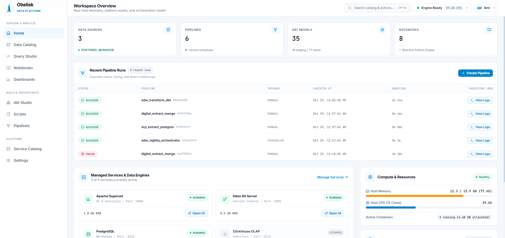
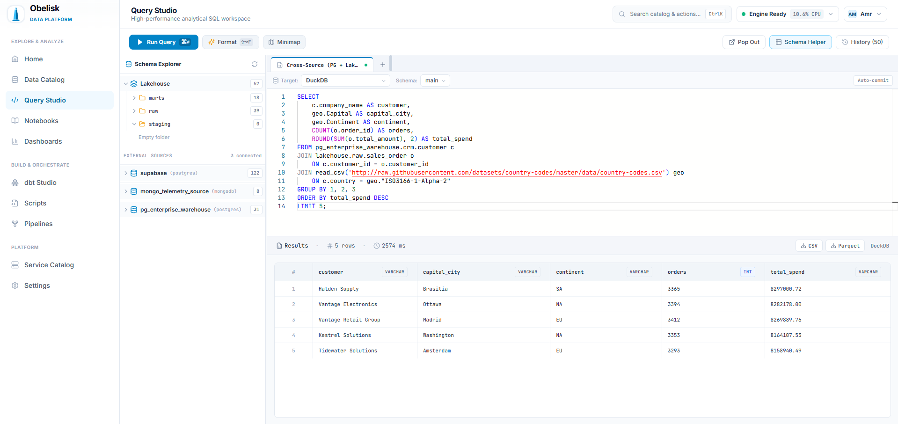
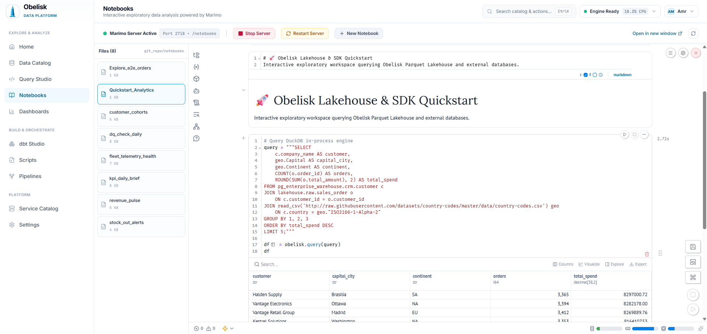
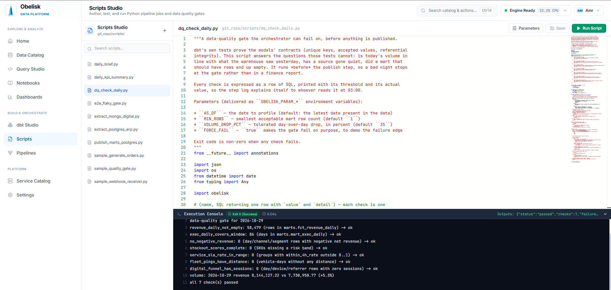

# Obelisk

<div align="center">

**The Pluggable On-Premise Data Platform & Control Plane**

Run a complete modern data stack on a workstation, a single server, or an air-gapped appliance.

[](LICENSE)
[](https://www.python.org/)
[](https://duckdb.org/)
[](https://fastapi.tiangolo.com/)
[](https://react.dev/)

<p align="center">
  
</p>

</div>

---

## What it is

Obelisk ingests from your databases, keeps the data as Parquet in a local lakehouse, queries
it in-process with DuckDB, and runs dbt, notebooks and scripts on a schedule. No cloud
warehouse, no cluster to operate, no egress bill.

- **In-process DuckDB over Parquet.** Vectorized analytical SQL straight off the files.
- **The catalog is powered by DuckLake.** Backed by `data/lakehouse/.obelisk/catalog.sqlite`, pairing SQLite metadata with multi-file Parquet partitions for zero-copy queries and atomic commits.
- **One orchestrator, in-process.** Scripts, notebooks, dbt, raw SQL, webhooks and other
  pipelines, wired with `success` / `failure` / `completion` / `skipped` edges.
- **Federation when you need it.** External sources (Postgres, MySQL, MariaDB, and MongoDB) attach live into DuckDB, so one query
  can join them to lakehouse tables. The editor and every pipeline step share the resolver.
- **Batteries included.** Monaco SQL studio, dbt Studio with lineage, reactive Marimo
  notebooks stored as `.py`, an encrypted vault, and hardware-aware container sizing.

## Status

Under active development.

**Authentication & Access Control.** Obelisk includes full session authentication (`OBELISK_AUTH_ENABLED=1` in Docker Compose),
an initial setup wizard (`/setup`), scrypt password hashing, and role-based session tokens. On standalone single-operator checkouts,
`OBELISK_AUTH_ENABLED=0` allows local access without a login wall.

The in-app terminal is a **real shell on the host** -- origin-gated, session-capped and
audited, but a shell. Set `OBELISK_TERMINAL=0` to remove it on a shared deployment.

## Quickstart

Python 3.12+ and Node 20+ (Node is only needed for the UI dev server).

```bash
git clone https://github.com/amrelsawalhi/obelisk.git
cd obelisk
cp .env.example .env      # Windows: copy .env.example .env

# Windows
run_obelisk.bat

# Linux / macOS / WSL
bash run_obelisk.sh
```

One command starts the API on `:8000` and the UI on `:5173`, then opens the browser. The
launcher guards port 8000 and replaces a stale listener (`run_obelisk.bat --restart`).

Other installs -- production Docker behind a Caddy gateway on `:80`, a systemd unit, or a
manual venv -- are in [docs/configuration.md](docs/configuration.md).

Want live sources to play with? `docker compose -f docker-compose.sources.yml up -d` starts
Postgres on `:5434` and MongoDB on `:27018`.

## What you can do

**Catalog and ingest.** Introspect lakehouse folders and connected databases, then stream
tables in as Snappy Parquet with `snapshot`, `incremental` (watermark) or `upsert`
(primary key) semantics. Attachable sources (Postgres, MySQL, MariaDB, and MongoDB) can also be queried live, uncopied.

**Query Studio.** DuckDB in-process analytical SQL, CSV and Parquet export, a virtualized grid, and
cross-source federated joins in a single statement:

```sql
SELECT 
    c.company_name AS customer,
    geo.Capital AS capital_city,
    geo.Continent AS continent,
    COUNT(o.order_id) AS orders,
    ROUND(SUM(o.total_amount), 2) AS total_spend
FROM pg_enterprise_warehouse.crm.customer c
JOIN lakehouse.raw.sales_order o 
    ON c.customer_id = o.customer_id
JOIN read_csv('http://raw.githubusercontent.com/datasets/country-codes/master/data/country-codes.csv') geo
    ON c.country = geo."ISO3166-1-Alpha-2"
GROUP BY 1, 2, 3
ORDER BY total_spend DESC
LIMIT 5;
```

<p align="center">
  
</p>

**Pipelines.** A visual DAG canvas with conditional branching; step **outputs** bound downstream
(`{{steps.build.table}}`); retry policies; sub-pipeline triggers; and streaming step logs.

<p align="center">
  
</p>

**dbt Studio.** Edit, compile, preview, and run models in the browser with DAG lineage and 50-row instant data preview.

<p align="center">
  
</p>

**Notebooks.** Reactive Marimo notebooks saved as plain `.py` scripts under `git_repo/notebooks/`, querying the lakehouse via the Obelisk Python SDK (`obelisk.query`), runnable interactively or headlessly in pipelines.

<p align="center">
  
</p>

**Scripts Studio & Quality Gates.** Author and execute standalone Python scripts, data quality gates, and automated alert handlers with live execution telemetry and console streaming.

<p align="center">
  
</p>

**Vault.** Variables and credentials encrypted at rest with Fernet and decrypted only in
memory, at execution time: `obelisk.var("OPENAI_API_KEY")`.

## Verify it works

```bash
cd backend
python -m pytest tests -q                        # the backend test suite, no external services needed
python scripts/preflight_port.py                 # port availability and preflight checks
```

The end-to-end script seeds real sources, drives ingest, dbt and federated SQL, forces every
edge condition, then reconciles the lakehouse against the sources -- no expected value is
hardcoded. Details in [docs/testing.md](docs/testing.md).

## Learn more

- [How it works](docs/how-it-works.md) -- the control plane, the seven seams, the run model
- [Python SDK](docs/sdk.md) -- `table`, `query`, `save`, `var`, `spark`
- [Configuration](docs/configuration.md) -- every environment variable, ports, installs
- [Testing](docs/testing.md) -- the zero-mock discipline and both verification harnesses
- [`.env.example`](.env.example) -- the canonical settings list

## License

MIT -- see [LICENSE](LICENSE).

Built with ❤️ for data engineers who value speed, autonomy, and simplicity.
